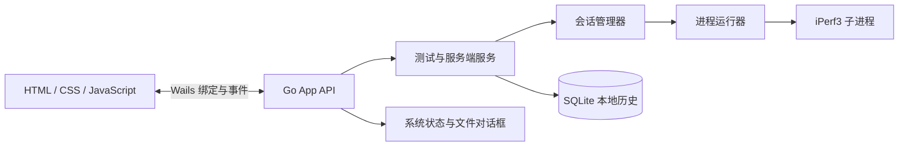

# iPerf3 GUI：Go + Wails 设计方案

状态：待实施  
目标平台：Windows x64 优先  
界面基础：[iperf3-gui-demo.html](../iperf3-gui-demo.html)

## 1. 设计结论

采用 Go + Wails 构建本机桌面应用，复用现有 HTML、CSS 和大部分页面布局。Wails 前端通过生成的 Go 绑定调用应用方法，通过 Wails 事件接收实时指标；Go 负责校验配置、启动和管理 iPerf3 子进程、解析结果及保存历史。

应用不另起本机 HTTP 服务。iPerf3 是独立子进程，不属于 Wails 或 Go 运行时。首期按单用户、Windows x64、本机 GUI 的场景设计，覆盖 TCP/UDP 客户端测试、本机服务端控制、结果查看和本地历史记录。

## 2. 目标与范围

### 首期目标

- 启动时检查 iPerf3 可执行文件、版本和所需输出能力。
- 运行 TCP/UDP 客户端测试，展示发送端、接收端吞吐及协议适用指标。
- 支持时长、报告间隔、并行流、反向测试、绑定地址和 IP 版本等参数。
- 管理本机 iPerf3 服务端，包括监听端口、绑定地址和单次连接模式。
- 实时显示运行状态、区间数据、原始输出、错误和退出码。
- 将完成的测试保存到本地历史，支持查询和 JSON/CSV 导出。
- 应用退出时停止其启动的子进程并关闭本地存储。

### 暂不包含

- 远程代理、云端同步、用户账户或多用户权限。
- 任意命令行参数编辑、自动扫描网段或并发压测任务队列。
- SCTP、第三方服务器管理和 iPerf3 服务端守护进程配置。
- 保证所有 iPerf3 旧版本都提供相同的实时数据能力。

## 3. 总体结构



前端继续使用当前单页工作区：客户端、服务端、历史记录三个视图。启动测试、服务端启停和文件导出改为调用 Go 绑定；实时指标由 Go 事件推送，不在前端使用 `Math.random()` 或定时器生成测试数据。

建议的代码边界：

```text
iperf3-gui/
├─ main.go                      # Wails 生命周期与窗口配置
├─ app.go                       # 暴露给前端的绑定方法
├─ frontend/
│  ├─ index.html                # 从现有 demo 迁入并逐步拆分
│  ├─ styles.css
│  └─ app.js
└─ internal/
   ├─ appservice/               # 用例编排与依赖注入
   ├─ iperf/                    # 可执行文件探测、参数构造、进程 I/O
   ├─ session/                  # 状态机、事件与输出解析
   ├─ history/                  # SQLite 持久化
   └─ model/                    # 配置、指标、结果类型
```

`app.go` 只负责把 Wails 调用转成应用服务调用，不承载参数规则、进程控制或解析逻辑。进程运行器和存储均通过接口注入，便于单元测试和替换实现。

## 4. 前端与 Go 的接口

前端使用 Wails 生成的 JS 绑定调用下列方法。方法返回值采用结构化对象；错误包含稳定错误码和可展示消息，不把 Go 堆栈直接暴露给普通界面。

| 方法 | 用途 |
| --- | --- |
| `GetSystemStatus()` | 返回 iPerf3 是否可用、版本、能力、接口列表 |
| `StartClientTest(config)` | 校验配置并创建测试会话，返回 `runId` |
| `StopClientTest(runId)` | 请求停止指定测试 |
| `GetRunSnapshot(runId)` | 返回当前状态和最新数据，弥补前端订阅事件时的竞态 |
| `StartServer(config)` | 启动本机服务端，返回 `serverId` |
| `StopServer(serverId)` | 停止指定服务端进程 |
| `ListHistory(filter)` | 查询本地历史摘要 |
| `GetHistoryResult(id)` | 加载完整结果及原始输出 |
| `ExportResult(id, format)` | 显示系统保存对话框并导出 JSON 或 CSV |

Go 通过 Wails 事件推送状态变化。每个事件都包含会话 ID 和递增序号，前端按 ID 过滤，避免客户端和服务端事件混淆。

| 事件 | 主要内容 |
| --- | --- |
| `run:state` | `runId`、状态、开始时间、状态说明 |
| `run:interval` | 区间起止、发送/接收 bit/s、TCP 重传或 UDP 指标 |
| `run:completed` | 最终摘要、退出码、结果记录 ID |
| `run:failed` | 失败阶段、错误码、用户可读原因、有限长度的 stderr 摘要 |
| `server:state` | `serverId`、监听地址、端口、状态 |
| `server:log` | `serverId`、时间和日志行 |

前端调用 `StartClientTest` 取得 `runId` 后订阅事件，再调用 `GetRunSnapshot` 获取当前快照。这样即使启动事件早于订阅，也不会让界面停留在错误状态。离开页面或切换视图时取消相应监听；运行会话不随视图切换而停止。

## 5. iPerf3 进程与会话管理

### 状态模型

客户端测试与服务端分别管理，单个应用同时最多运行一个客户端测试；服务端可与客户端并存。同一绑定地址和端口只允许一个服务端会话。

```text
created → starting → running → stopping → stopped
                    ├────────→ completed
                    └────────→ failed
```

状态迁移由会话管理器统一维护。重复停止返回当前状态；已结束会话不能再次启动或停止。窗口关闭时，应用服务取消其拥有的所有运行上下文，等待子进程退出并回收资源。

### 命令构造

Go 根据结构化配置构造参数数组并使用 `exec.CommandContext` 启动，不经过 shell，也不执行前端传入的命令字符串。示例仅用于说明参数映射：

```text
TCP: iperf3 -c <host> -p <port> -t <seconds> -i <interval> -P <streams>
UDP: iperf3 -c <host> -p <port> -u -b <rate> -l <length> -t <seconds> -i <interval>
反向: 在对应客户端参数后追加 -R
服务端: iperf3 -s -p <port> [-B <address>] [-1]
```

反向测试时仍将发送端和接收端作为数据字段分别保存，不依赖“客户端总是发送端”的假设。命令预览由同一参数构造器生成，但预览文本不会回传给进程执行。

目标地址允许域名、IPv4 或 IPv6；后端拒绝空值、控制字符和以 `-` 开头的值。端口、时长、间隔、并行流、带宽和数据报长度都在 Go 层重新校验，不能只依赖 HTML 表单限制。

### 进程 I/O 与停止

- stdout 和 stderr 必须并行读取，避免管道缓冲区写满后进程阻塞。
- 每个会话只由一个 goroutine 调用 `cmd.Wait()`；读写、停止和完成状态通过会话对象同步。
- 原始输出保留在有限大小的缓冲区中；stderr 摘要和退出码写入结果，避免异常输出无限占用内存。
- Windows 停止流程由平台适配层负责。原型阶段验证 `CommandContext` 取消、进程退出等待和应用关闭后的子进程回收；若目标二进制需要更温和的停止信号，再实现对应的 Windows 进程控制，不用假设 Unix 信号语义可直接移植。
- 端口占用、启动失败、DNS 失败、连接超时、用户停止和解析失败分别记录明确错误码及阶段。

### 实时数据与版本兼容

iPerf3 不同版本的 JSON 和文本输出能力存在差异，不能假设最终报告 JSON 一定包含实时区间。启动时探测 `--version` 与可用输出选项，由 `OutputAdapter` 明确选择支持的解析方式：优先使用目标版本提供的 JSON 流式输出；不支持时，使用带固定测试样本的区间文本解析器，或明确告知该版本只能提供结束后的结果。运行模式和解析器版本写入测试记录，不静默切换到模拟数据。

归一化后的区间对象至少包含：

```text
runId, sequence, startSeconds, endSeconds,
senderBitsPerSecond, receiverBitsPerSecond,
tcpRetransmits?, udpJitterMilliseconds?, udpLostDatagrams?, udpTotalDatagrams?
```

TCP 页面显示吞吐和重传；UDP 页面显示吞吐、抖动和丢包。原始输出可供诊断，JSON 导出使用 Go 侧的归一化结果结构，避免前端自行从文本拼装报告。

## 6. 服务端、历史与本机数据

服务端作为独立长运行会话，由 Go 记录监听地址、端口、启动时间、退出码和日志。单次连接模式映射到 iPerf3 的 `-1`；端口占用时返回明确错误，不自动换端口。服务端输出中的连接信息经过解析后推送到页面。

测试历史使用 SQLite，数据库放在 `%LOCALAPPDATA%\Iperf3GUI\iperf3.db`。保存配置快照、协议、方向、区间结果、汇总、解析器版本、退出码和必要的原始输出。数据库通过 `user_version` 管理迁移。最近一次配置单独保存为 JSON，不保存凭据或敏感信息。

区间结果逐条写入 SQLite；实时图表只保留最近 300 个采样点，历史详情按页查询。stdout 原始输出和 stderr 摘要使用有上限的缓冲区；达到上限时标记为已截断，不静默丢弃输出。

JSON/CSV 导出由 Go 使用 Wails 文件保存对话框取得用户选择的路径，再写入文件。页面不依赖浏览器默认下载目录。

## 7. 安全与错误边界

- Wails 只暴露本设计列出的有限方法；不提供通用 shell、任意可执行路径或任意参数接口。
- iPerf3 路径由启动探测或受控设置选择，前端不能覆盖进程环境变量或工作目录。
- 绑定地址、目标地址、端口及数值参数在 Go 层统一验证；所有外部进程参数独立传递。
- 用户可恢复错误显示在对应配置或结果区域；保留退出码和 stderr 摘要以便排查，不吞掉异常。
- 日志不记录凭据；保存的目标地址与结果仅留在本机应用数据目录。

## 8. 界面迁移

以当前 demo 的三个视图和桌面双栏布局为基础，不重新设计视觉系统。客户端视图保留目标、协议、时长、并行流、高级参数、命令预览、实时曲线、区间表格和原始输出；服务端视图显示监听状态、连接记录和日志；历史视图改读 SQLite。

需要替换的模拟逻辑包括 `beginTest` 中的 `setInterval` 和随机数、静态服务端连接记录、内存历史数组及浏览器文件下载。开始测试前显示 iPerf3 探测结果；运行中锁定本次配置并提供停止操作；完成后显示真实汇总；失败时显示错误阶段和可展开的原始输出。演示模式标签在真实版本中替换为引擎状态，不再展示样例数据。

## 9. 打包与运行

- Wails 构建时将前端静态资源嵌入应用；应用窗口初始大小建议约 `1280 × 820`，设置合理最小尺寸。
- 首期生成 Windows x64 安装包或便携包，并在干净 Windows 环境验证 WebView2 Runtime 检测和启动体验。
- Go 可执行文件与 iPerf3 是两个不同组件。首期建议探测 PATH 和应用配置的 iPerf3 路径；缺失时提供明确安装/配置提示。是否随包分发 `iperf3.exe` 在实施前单独决定，并核对其许可证、版本、架构及第三方声明。
- SQLite 文件和诊断日志写入用户应用数据目录；卸载不应默认删除用户历史。
- 正式分发时对安装包签名，并记录 Go、Wails、iPerf3 和 WebView2 的目标版本信息。
- 内存验证统计 Wails 主进程及其关联 WebView2 子进程；记录空闲、测试运行中和长时间测试后的占用，避免只观察 Go 主进程而漏掉 WebView2。

## 10. 验证方案

### 单元测试

- 参数构造：TCP、UDP、反向、绑定地址、IPv4/IPv6、服务端单次模式及非法输入。
- 输出解析：TCP/UDP、正向/反向、不同 iPerf3 版本的 JSON 流和文本样本；覆盖截断、未知字段和异常行。
- 会话状态：启动、停止、完成、启动失败、重复停止及退出回收。
- 历史存储：写入、查询、导出字段和数据库迁移。

### 集成测试

- 在本机启动 iPerf3 服务端，再运行 TCP 和 UDP 客户端测试，检查真实吞吐和结束汇总。
- 测试服务端端口冲突、无效目标、停止运行中的测试及关闭应用后无遗留子进程。
- 验证 CSV/JSON 导出、历史重启后仍可查询，以及 Windows WebView2 不可用时的清晰错误。
- 进行至少 30 分钟的持续采样和多轮启停测试，检查进程内存是否持续增长、图表缓冲是否有界、关闭应用后是否残留进程。

测试运行需要本机 iPerf3 和可用网络时，应在结果中明确标出前置条件；不得用模拟成功结果代替集成测试。

## 11. 分阶段实施

1. **Wails 外壳与系统探测**：创建 Go/Wails 工程，嵌入现有 HTML，完成窗口、`GetSystemStatus`、iPerf3 路径和版本检测。
2. **客户端 TCP 测试**：完成配置校验、参数构造、进程生命周期、真实汇总和停止流程。
3. **实时指标与 UDP**：完成输出能力探测、解析适配器、事件推送和协议专属指标。
4. **服务端管理**：加入监听进程、单次模式、端口冲突、连接日志和应用退出清理。
5. **历史与分发**：加入 SQLite、导出、安装包、WebView2 检查和干净机器验证。

## 12. 首期验收条件

- 未安装 iPerf3 时，应用显示可理解的缺失状态，不伪造可运行状态。
- TCP/UDP 测试展示真实区间数据和最终汇总；方向及发送端/接收端含义明确。
- 停止测试或退出应用后，相关 iPerf3 进程可确认退出。
- 服务端端口冲突有明确反馈，单次连接完成后按配置停止。
- 历史在应用重启后仍存在，导出文件与界面汇总一致。
- 页面没有横向溢出；窗口缩放、DPI 和字体在目标 Windows 环境通过检查。
